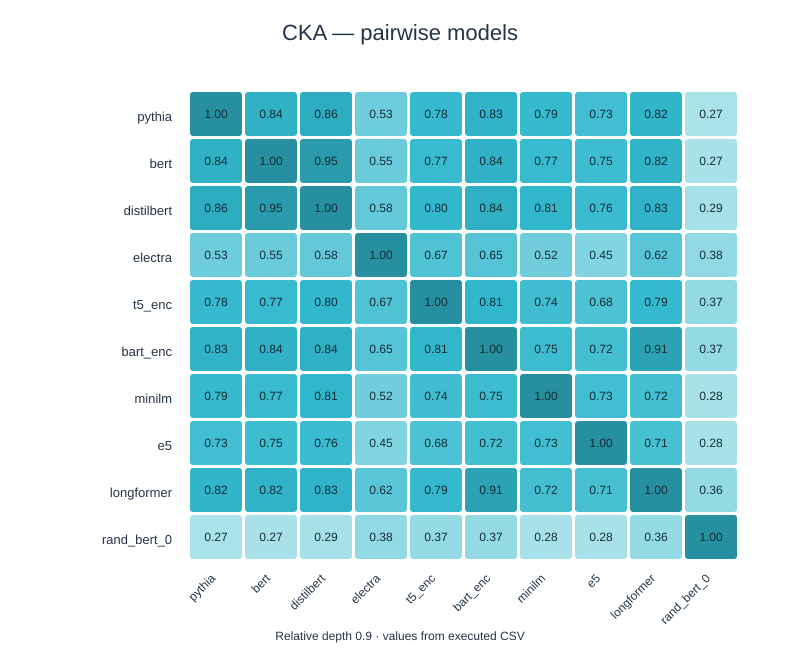
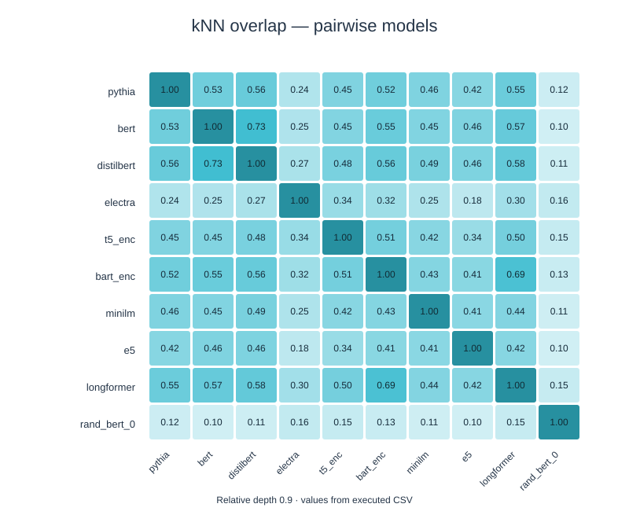
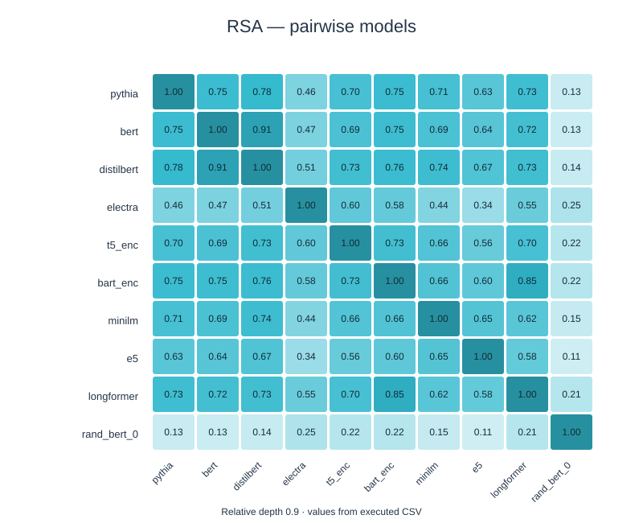
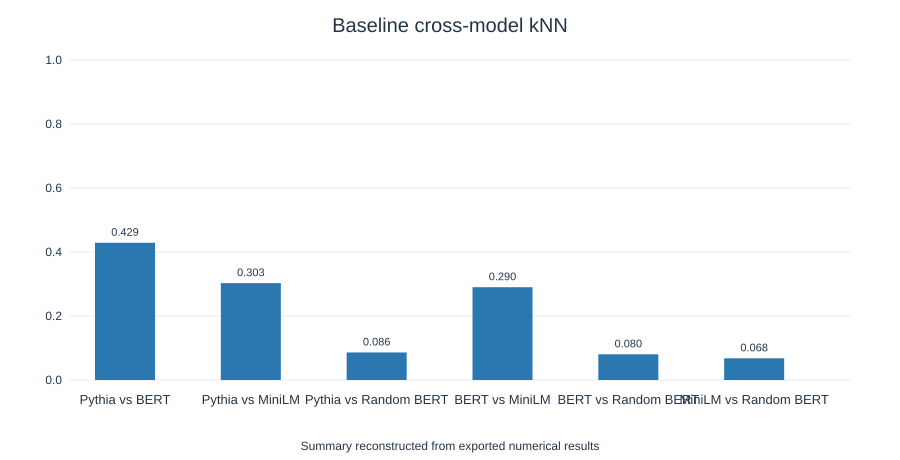
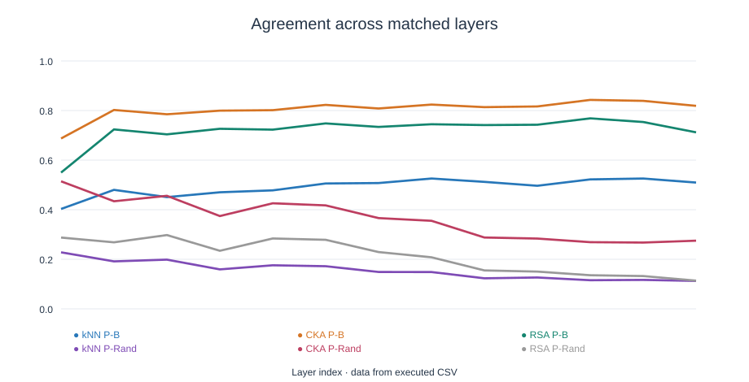
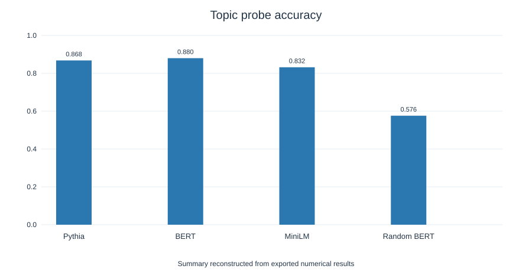
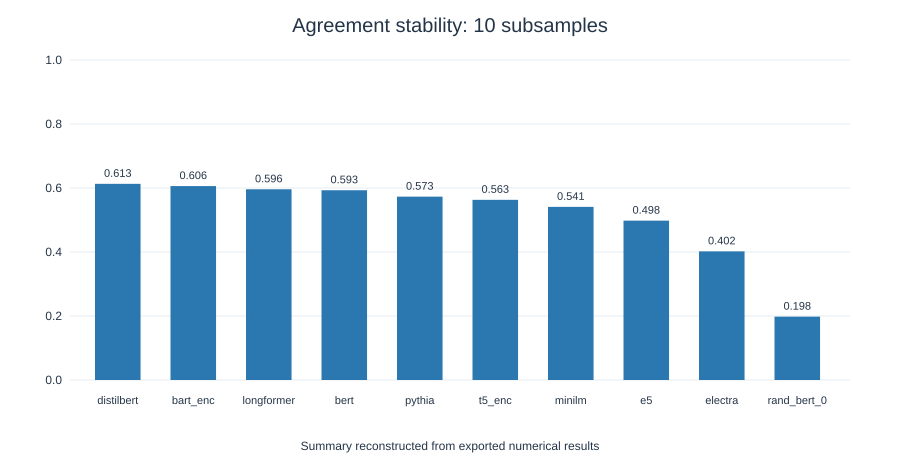
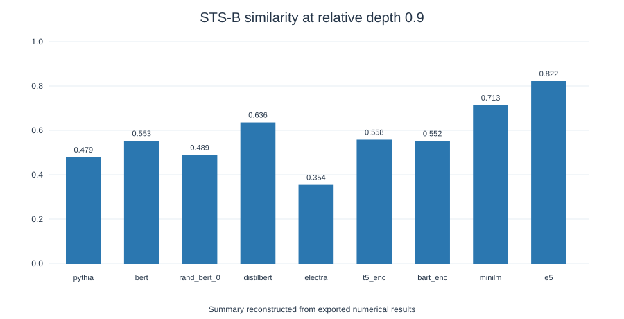

# Study 02 — Cross-Model Hidden-State Analysis

This study extends [Study 01](../01-hidden-state-agreement/) from three primary models to a wider range of transformer architectures and evaluates whether representational agreement corresponds to meaningful task performance.

## 1. What did we want to discover? — Research hypothesis

**Hypothesis:** Some representational geometry may be shared across transformer families, but its strength and relationship to task performance will vary with architecture, layer depth, and training objective. Neighbours on which more models agree may have more topical or lexical similarity.

## 2. How did we test it? — Experiments, metrics and controls

### Reproduce

Open [02_cross_model_analysis.ipynb](02_cross_model_analysis.ipynb) in Google Colab, enable a GPU, and select **Runtime → Run all**. It runs on 2,000 balanced English AG News texts (500 per topic); the cross-model CKA/RSA subset contains 400 texts. Detailed configuration, preprocessing, random seeds and execution steps are recorded inside the notebook.

The uploaded notebook is the **clean runnable version**. Results in [results/](results/) come from the completed Colab run. The separately downloaded executed notebook, including outputs, was inspected and completed its 16 code cells without reported Python exceptions.

### Experiments and controls

The measurements use **kNN overlap** (shared top-k neighbours), **CKA** (representation similarity), **RSA** (agreement in pairwise-distance geometry), a **held-out linear topic probe**, **Spearman correlation** for STS-B, and **ROC-AUC** for PAWS. Controls include randomly initialized BERT, variations across layers, and a lexical word-overlap comparison when examining neighbour consensus. The model-family comparisons are descriptive, not randomized causal interventions.

1. **Baseline model agreement and topic probing** — Pythia, BERT, MiniLM, and randomly initialized BERT, evaluated by kNN, CKA, RSA, and a held-out linear classification probe.
2. **Layerwise comparisons** — matched-index layers, Pythia–BERT CKA grid and classification accuracy by layer.
3. **Expanded cross-model comparisons** — Pythia, BERT, DistilBERT, ELECTRA, T5 encoder, BART encoder, MiniLM, E5, Longformer and a random BERT control, at relative depth 0.9.
4. **Neighbour consensus** — common nearest neighbours across multiple models and associations with AG News topic labels and word overlap.
5. **Subsampling stability** — repeated scoring on ten random subsamples from the same dataset, not ten independent corpora.
6. **External tasks** — STS-B (Spearman correlation with human similarity judgments) and PAWS (paraphrase ROC-AUC).

Optional experiments using Nano autoregressive/diffusion models and TinyStories are included but **were not executed** in the supplied run (flags disabled).

## 3. What did we learn? — Results, interpretation and limitations

### Selected observations

- BERT and DistilBERT show strong representation similarity at relative depth 0.9 (CKA approximately **0.95**, kNN approximately **0.73**, RSA approximately **0.91**), consistent with their close model family; this should not be treated as an independent-architecture discovery.
- Randomly initialized BERT tends to have substantially lower agreement with trained models.
- Neighbours selected by more models tend to share an AG News topic more often, but also have higher word overlap. This means lexical effects remain an important competing explanation.
- STS-B and PAWS performance varies substantially by architecture and depth. High geometric similarity does **not** by itself establish better semantic or paraphrase performance.

## Data

Machine-readable outputs are in [results/](results/):

- [baseline_agreement.csv](results/baseline_agreement.csv), [topic_probes.csv](results/topic_probes.csv)
- [layerwise_agreement.csv](results/layerwise_agreement.csv), [cka_grid.csv](results/cka_grid.csv)
- [matrix_kNN.csv](results/matrix_kNN.csv), [matrix_CKA.csv](results/matrix_CKA.csv), [matrix_RSA.csv](results/matrix_RSA.csv)
- [resampling_summary.csv](results/resampling_summary.csv), [sts_paws.csv](results/sts_paws.csv)

### Interpretation

Cross-model agreement exists, but varies widely. The particularly high agreement of BERT and its distilled relative should not be mistaken for independent convergence. More widespread neighbour agreement corresponds to both topic similarity and word overlap, so task performance is a useful additional check rather than a guaranteed consequence.

### Limitations

The AG News sample is small and restricted to English news topics; nearest-neighbour agreement may reflect words, topic, or other shared signal rather than the same learned concepts. Across-model comparisons are influenced by tokenizer, training objectives, architecture, representation pooling, layer depth and standardization. Some models are directly related by training or distillation. The ten resamples are overlapping and their dispersion is a *stability diagnostic*, not a confidence interval for arbitrary future datasets. STS-B and PAWS are additional task checks and should not be interpreted as causal tests of representational alignment.

The uploaded notebook's successful original run does not guarantee identical outputs under future Colab library/model versions.

## Figures

These are **summary SVG charts reconstructed from the exported CSV values**, rather than copies of the original PNG plots from Colab. The full original charts (including neighbour consensus and STS-B/PAWS layer curves) are available by running the notebook; only quantities present in the CSV exports were reconstructed here.

### Cross-model agreement

### Baselines, layers, and probes

### Stability and external evaluations

For PAWS and the best observed STS-B/PAWS scores, use [sts_paws.csv](results/sts_paws.csv). The SVG above shows *only* STS-B at relative depth 0.9, not PAWS.

## Executed Google Colab notebook

[View executed notebook with saved outputs](https://colab.research.google.com/drive/1dTj56VHA-SmKQvueUFHWCe4D4Wl4ahoU?usp=sharing) — the shared Colab copy showing the experiment run. For the version-controlled source, use the notebook linked above in this repository. The shared notebook is viewable without signing in (checked by the repository owner in a private browsing window).
