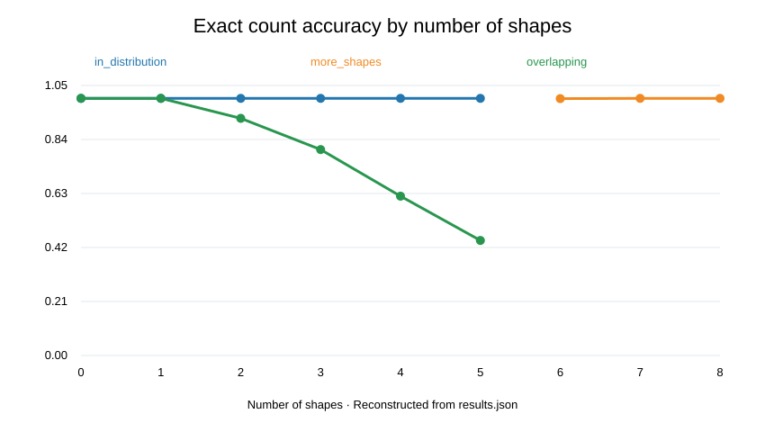
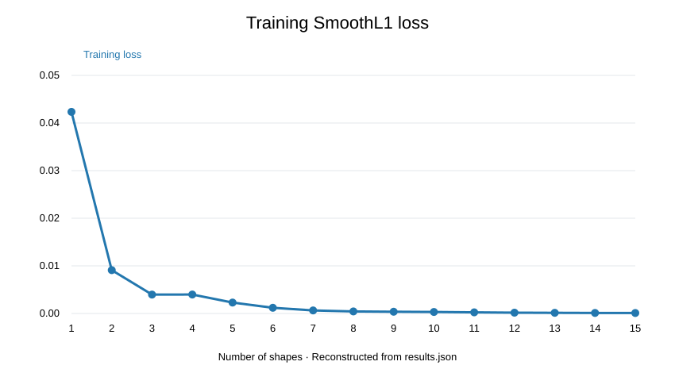

# Study 04 — CNN Visual Counting and Generalization

## What did we want to learn?
Can a convolutional neural network count synthetic shapes by shape–colour category, and does it generalize to **more objects** or **overlapping objects** than encountered during training?

The task uses 12 output categories (3 shapes × 4 colours), with total object count as an additional derived metric.

## How did we test it?
- **Model:** convolutional backbone with spatial density-sum head, trained with SmoothL1 loss.
- **Training:** 60,000 synthetic images containing **0–5** objects, 15 epochs, batch size 256, seed 0, GPU supported.
- **Evaluation:** three independent synthetic sets of 3,000 images each: in-distribution 0–5 objects; 6–8 objects without overlap; 0–5 objects with overlap.
- **Metrics:** rounded exact total count, rounded exact 12-category count vector, absolute count errors and accuracy conditional on actual count.
- **Source:** [Colab notebook](04_visual_counting_cnn.ipynb); [full numerical results](results/results.json).

## What did we observe?

| Evaluation scenario | Exact total count | Exact 12-category vector | Total-count MAE (continuous predictions) |
|---|---:|---:|---:|
| 0–5, normal | 100.00% | 100.00% | 0.0507 |
| 6–8, more shapes | 99.97% | 99.97% | 0.0849 |
| 0–5, overlapping | 80.20% | 80.20% | 0.3284 |

The model generalized extremely well to larger counts **within this generator**, but overlapping objects were more challenging. With overlaps, exact-total accuracy fell from 100% for 0–1 objects to 44.7% for five objects.

**Metric distinction:** exact-total and exact-12-class accuracy are calculated separately. Their identical observed values in this run do not make them interchangeable measures. Continuous-prediction MAE can be nonzero even when rounded predictions are correct.

## Results and figures

The SVG graphs above were reconstructed from the saved JSON values, **not copied from the original Colab PNG files**.

## Reproducibility and limits

Open the notebook in Google Colab, select a GPU, and run from top to bottom. It saves the model weights locally as `model.pt`, together with the JSON results. The weights are **not committed** to this repository.

- The image distributions are procedural; near-perfect accuracy does **not** imply real-world counting performance.
- The shapes, colours, sizes and image generation conventions may make the task easier than natural-image counting.
- The 6–8-shape result is extrapolation in count under similar generation rules, not arbitrary out-of-distribution generalization.
- The notebook evaluates the first (in-distribution) test set each epoch, so that set should be treated as validation rather than an untouched final test set if it influenced training decisions.
- An optional pooled-head baseline exists in the notebook but was disabled for this run. No comparative claim between heads is supported.
